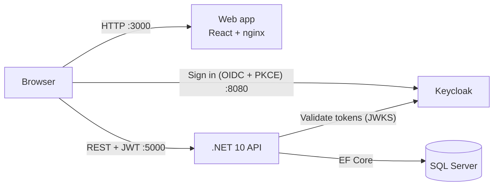

# Transaction Dispute Portal

A full-stack system where bank customers view their transactions, dispute the ones they don't recognise, and follow every dispute they've raised. Dispute agents work a queue of open disputes, review them and approve or reject them, and the customer sees each decision in their dispute history.

This repository holds the **.NET 10 API** and the **Docker Compose** setup for the whole stack. The React web app lives in [`transaction-dispute-portal-web`](https://github.com/McebisiMK/transaction-dispute-portal-web).

| Brief requirement | Where it's covered |
|---|---|
| Customers view their transactions | `GET /api/v1/transactions`, the Transactions page (search, status and date filters, paging) |
| Customers dispute transactions | `POST /api/v1/disputes`, the Dispute page, enforced by the [dispute rules](#dispute-rules) |
| Historic view of disputed transactions | `GET /api/v1/disputes`, the My Disputes page and each dispute's status timeline |
| Production grade | [Production readiness](#production-readiness), [tests](#testing), [design decisions](#design-decisions) |
| Runnable Dockerfile | `Dockerfile` (API), the web repo's `Dockerfile` (nginx), `docker-compose.yml` for the full stack |
| README covering build, run and test | This file and the web app's README |

## Contents

- [Quick start](#quick-start)
- [Architecture](#architecture)
- [Features](#features)
- [Running locally without Docker](#running-locally-without-docker)
- [Testing](#testing)
- [Configuration](#configuration)
- [Production readiness](#production-readiness)
- [Authentication](#authentication)
- [API](#api)
- [Database migrations](#database-migrations)
- [TypeScript API client](#typescript-api-client)
- [Design decisions](#design-decisions)
- [Known limitations and next steps](#known-limitations-and-next-steps)

## Quick start

### Prerequisites

- [Docker Desktop](https://www.docker.com/products/docker-desktop/) (or Docker Engine with Compose v2)
- Git
- Free ports: `3000` (web), `5000` (API), `8080` (Keycloak), `1433` (SQL Server)

The .NET SDK and Node are only needed to [run the apps outside Docker](#running-locally-without-docker) or to [run the tests](#testing).

### Run the whole stack

Compose builds the web app from `../transaction-dispute-portal-web`, so clone both repositories into the same folder:

```bash
mkdir dispute-portal && cd dispute-portal
git clone https://github.com/McebisiMK/TransactionDisputePortal.git
git clone https://github.com/McebisiMK/transaction-dispute-portal-web.git

cd TransactionDisputePortal
cp .env.example .env
docker compose up -d --build
```

On Windows, clone into a short path such as `C:\src`. Some source paths are long, and a deep folder can hit Git's 260-character limit ("Filename too long"). Alternatively, turn on long paths first with `git config --global core.longpaths true`.

The first build takes a few minutes. When the API starts, it applies the database migrations and seeds the test data. Keycloak needs about 30 seconds to import the realm. The stack is ready when http://localhost:5000/health returns `Healthy`.

| Service | URL |
|---|---|
| Web app | http://localhost:3000 |
| API (Swagger) | http://localhost:5000/swagger |
| API health | http://localhost:5000/health |
| Keycloak admin console | http://localhost:8080 (`admin` / `admin` unless changed in `.env`) |
| SQL Server | `localhost,1433` (`sa` / `MSSQL_SA_PASSWORD` from `.env`) |

`.env` works as copied. The [configuration](#configuration) section explains each value.

### Test users

All three use the password `Password1!`. These are local test accounts that exist only in the bundled Keycloak realm.

| Username | Role | Data |
|---|---|---|
| `test.customer` | customer | Cheque and credit card account, 50 transactions, 5 disputes (one in each status) |
| `test.customer2` | customer | Cheque and credit card account, 50 transactions, 5 disputes (one in each status) |
| `test.agent` | agent | Sees every customer's disputes |

### A two-minute walkthrough

1. Open http://localhost:3000 and sign in as `test.customer`.
2. On **Transactions**, find a posted transaction with an enabled **Dispute** button, then choose a reason and submit. You get a reference such as `DSP-2026-000011`.
3. Open **My Disputes** to see it in your history, and open it to see its timeline.
4. Sign out and sign in as `test.agent`. Open the dispute from the **Dispute queue**, **Start review**, then approve or reject it with a comment.
5. Sign in as `test.customer` again. The dispute shows the decision and the agent's comment, and an approved transaction can no longer be disputed.

### Stop or reset

```bash
docker compose down        # stop, keep the data
docker compose down -v     # stop and delete the SQL Server and Keycloak data (fresh seed on next start)
```

## Architecture



The browser loads the React app from nginx and signs in with Keycloak. It then calls the API directly with the access token. The API checks the token against Keycloak's signing keys and reads and writes SQL Server through EF Core.

The API follows Clean Architecture. Dependencies point inwards, so the domain has no framework dependencies:

```
TransactionDisputePortal.Domain          Entities, enums, domain rules (Dispute.Submit, StartReview, Resolve, Withdraw) and domain events
TransactionDisputePortal.Application     Use cases as MediatR commands and queries, FluentValidation validators, DTOs, AutoMapper profiles
TransactionDisputePortal.Infrastructure  EF Core (SQL Server), migrations, seeding, the dispute reference sequence, current-user services
TransactionDisputePortal.API             Controllers, authentication and authorisation, ProblemDetails mapping, health checks, rate limiting, middleware
TransactionDisputePortal.API.Client      Generates the TypeScript client for the web app from the OpenAPI document
TransactionDisputePortal.UnitTests       Domain, handlers, validators and mapping (NUnit, NSubstitute, FluentAssertions)
TransactionDisputePortal.IntegrationTests  The real HTTP pipeline through WebApplicationFactory
```

A request goes through the controller, then `ISender.Send`, then the validation pipeline behaviour (FluentValidation), then the handler, then the domain entity, then `SaveChanges`. Domain events (`DisputeSubmitted`, `DisputeStatusChanged`, `DisputeWithdrawn`) are dispatched after the save. Their handlers log a simulated customer notification.

## Features

**Customer**
- **Transactions:** the customer's transactions across their accounts, newest first. Search by merchant or reference, filter by status and date range, with server-side paging. Each row shows whether it can be disputed and why not.
- **Raise a dispute:** choose a reason (the list comes from the API), add a description (required for *Other*), and get a readable reference.
- **My Disputes:** the dispute history, filtered by status and submission date.
- **Dispute details:** the transaction, reason, description and a timeline of every status change, with who made it, when and their comment.
- **Withdraw:** the customer can withdraw a dispute while it is still *Submitted*. The transaction can then be disputed again.

**Agent**
- **Dispute queue:** all customers' open disputes, oldest first, or any one status.
- **Review:** start the review, then approve or reject with a comment the customer sees.
- **Concurrency:** if two agents act on the same dispute, the second gets a clear message and the latest version, never a silent overwrite.

### Dispute rules

- A customer can only dispute their own transactions (`404` otherwise).
- Only `Posted` transactions can be disputed, and only within 120 days of the transaction date (`409`).
- A transaction can have only one open (`Submitted` or `UnderReview`) dispute at a time (`409`). The handler checks this, and a filtered unique index enforces it, so two simultaneous requests can't both succeed.
- A transaction with an `Approved` dispute has already been refunded and can't be disputed again (`409`). After a `Rejected` or `Withdrawn` dispute, the customer can dispute it again while it is still within the dispute window.
- Reasons: `UnauthorisedTransaction`, `DuplicateCharge`, `IncorrectAmount`, `GoodsOrServicesNotReceived`, `NotAsDescribed`, `CancelledSubscription`, `RefundNotReceived`, `Other`. `Other` needs a description (max 1000 characters).
- Each dispute gets a readable reference such as `DSP-2026-000123`, numbered from a SQL Server sequence.
- A new dispute starts as `Submitted` with a first entry in its status history, and a simulated "Dispute received" notification is logged.
- A customer can withdraw their own dispute only while it is `Submitted` (`409` once it is under review or closed). It moves to `Withdrawn` with a history entry, a simulated notification is logged, and the transaction can be disputed again.
- An agent moves a dispute from `Submitted` to `UnderReview`, then resolves it as `Approved` or `Rejected` with a comment for the customer. Any other change returns `409`. Each change adds a history entry, which the customer sees in their timeline, and logs a simulated notification to the customer.
- An agent sends back the `rowVersion` of the dispute they looked at. If the dispute has changed since (another agent updated it, or the customer withdrew it), the API returns `409` and the agent has to reload it.

## Running locally without Docker

Requirements: [.NET 10 SDK](https://dotnet.microsoft.com/download/dotnet/10.0) and, for the web app, [Node 24](https://nodejs.org/).

Start SQL Server and Keycloak in Docker, point the API at the containerised database, and run it:

```bash
docker compose up -d sqlserver keycloak

# bash
export ConnectionStrings__Default="Server=localhost,1433;Database=TransactionDisputePortal;User Id=sa;Password=Dispute_Portal_2026!;TrustServerCertificate=True;MultipleActiveResultSets=True;"
# PowerShell
$env:ConnectionStrings__Default = "Server=localhost,1433;Database=TransactionDisputePortal;User Id=sa;Password=Dispute_Portal_2026!;TrustServerCertificate=True;MultipleActiveResultSets=True;"

dotnet run --project TransactionDisputePortal.API --launch-profile http
```

Use your `MSSQL_SA_PASSWORD` if you changed it. On Windows you can skip the SQL Server container and the connection string: the default in `appsettings.json` uses LocalDB (`(localdb)\MSSQLLocalDB`).

The API runs on http://localhost:5000 in the `Development` environment, which turns on Swagger, seeding and HTTP (no HTTPS redirection). To set the licence key outside Docker, use user secrets:

```bash
dotnet user-secrets set "LuckyPennySoftware:LicenseKey" "<key>" --project TransactionDisputePortal.API
```

Then run the web app from `../transaction-dispute-portal-web` with `npm install` and `npm run dev`. Its README has the details.

## Testing

```bash
dotnet test TransactionDisputePortal.slnx
```

| Suite | Tests | What it covers |
|---|---|---|
| `TransactionDisputePortal.UnitTests` | 163 | Domain rules (submit, review, resolve, withdraw, the 120-day window), every command and query handler, validators, AutoMapper profiles, lookups |
| `TransactionDisputePortal.IntegrationTests` | 46 | The full HTTP pipeline through `WebApplicationFactory`: authentication and roles, customer data isolation (`404` for other customers' data), validation (`422`), business rule conflicts (`409`), concurrency, health checks, rate limiting, correlation IDs and security headers |

The integration tests replace Keycloak with a test authentication handler and SQL Server with EF Core InMemory. No Docker is needed to run them.

Without the .NET SDK installed, run the tests in the SDK container instead:

```bash
docker run --rm -v "$PWD:/src" -w /src mcr.microsoft.com/dotnet/sdk:10.0 dotnet test TransactionDisputePortal.slnx -p:GenerateApiClient=false
```

The web app has its own suite (Vitest, Testing Library and MSW). Run `npm test` in `../transaction-dispute-portal-web`.

## Configuration

Docker Compose reads `.env` next to `docker-compose.yml`. Copy `.env.example` to `.env`. `.env` is git-ignored, so secrets never reach the repository.

| Variable | Default | Purpose |
|---|---|---|
| `LUCKY_PENNY_LICENSE_KEY` | empty | Licence key for MediatR and AutoMapper (Lucky Penny Software). Optional for local use: without it the libraries work and only log a licence warning. A free community licence is available from [luckypennysoftware.com](https://luckypennysoftware.com). |
| `MSSQL_SA_PASSWORD` | `Dispute_Portal_2026!` | SQL Server `sa` password, used by both the database and the API's connection string |
| `KEYCLOAK_ADMIN_USERNAME` | `admin` | Keycloak admin console user |
| `KEYCLOAK_ADMIN_PASSWORD` | `admin` | Keycloak admin console password |

API settings (`appsettings.json`, overridden per environment and by environment variables such as `RateLimiting__Writes__PermitLimit`):

| Setting | Default | Development / Docker | Purpose |
|---|---|---|---|
| `ConnectionStrings:Default` | LocalDB | SQL Server container in Docker | Database |
| `DataSeedingOptions:Enabled` | `false` | `true` | Apply migrations and seed test data at start-up |
| `Keycloak:Authority`, `Keycloak:Audience` | local Keycloak realm | Docker also sets `Keycloak:MetadataAddress` to the internal Keycloak URL | Token validation |
| `Keycloak:RequireHttpsMetadata` | `true` | `false` | Allow plain-HTTP Keycloak locally |
| `Swagger:Enabled` | `false` | `true` | Swagger UI and OpenAPI document |
| `Hosting:UseHttpsRedirection` | `true` | `false` | HTTPS redirection and HSTS |
| `Cors:AllowedOrigins` | `http://localhost:3000` | | Web app origin |
| `RateLimiting:Writes:PermitLimit` / `WindowSeconds` | `10` / `60` | | Write requests allowed per user per window |
| `LuckyPennySoftware:LicenseKey` | empty | from `.env` or user secrets | See above |

## Production readiness

- **Health checks:** `/health/live` (liveness, the process is up) and `/health` (readiness, checks the database and Keycloak), returned as JSON. Both are anonymous and exempt from rate limiting.
- **Rate limiting:** write endpoints (creating, withdrawing and reviewing disputes) allow 10 requests per 60 seconds per user (per IP when anonymous). Over the limit, the API returns `429` with `Retry-After` and ProblemDetails. Reads are not limited.
- **Correlation IDs:** an incoming `X-Correlation-ID` (up to 64 letters, digits, `-`, `_` or `.`) is used as the request's trace identifier. Otherwise one is generated. It is returned in the response header, added to every log line and included as `correlationId` in error responses.
- **Security headers:** `X-Content-Type-Options: nosniff`, `X-Frame-Options: DENY`, `Referrer-Policy: no-referrer`, `Permissions-Policy`, `Cross-Origin-Opener-Policy`, and a strict `Content-Security-Policy` (relaxed for Swagger UI only). API responses also get `Cache-Control: no-store`, and the `Server` header is removed.
- **Consistent errors:** every error is RFC 7807 ProblemDetails: `422` validation (with field errors), `401`, `403`, `404`, `409` business rule or concurrency conflict, `429`, and `500`, which hides the exception message outside Development.
- **Structured logging:** Serilog writes to the console and to rolling files in `logs/` (14 days), enriched with the correlation ID, machine and thread, and logs one summary line per request.
- **Data integrity:** optimistic concurrency (`rowVersion`) on disputes, a filtered unique index for one open dispute per transaction, and a SQL Server sequence for dispute references.
- **Build quality:** `Directory.Build.props` turns on nullable reference types, the latest .NET analyzers, code-style enforcement on build, treat-warnings-as-errors, and a NuGet vulnerability audit. Package versions are managed centrally in `Directory.Packages.props`, and `.editorconfig` defines the code style.
- **Secrets:** nothing secret is committed. Values come from `.env`, environment variables or user secrets.
- **Images:** multi-stage Dockerfiles. The API runs on the ASP.NET runtime image, and the web app is a static build served by nginx with runtime configuration.

## Authentication

Keycloak handles authentication. The realm is imported from `keycloak/realm-export.json` the first time Keycloak starts. Keycloak's data, including its token signing keys, is kept in the `keycloak-data` volume, so tokens stay valid across Keycloak restarts.

Keycloak skips a realm that already exists, so later changes to `realm-export.json` are not applied automatically. To re-import it, remove the volume and start Keycloak again:

```bash
docker compose rm -sf keycloak
docker volume rm transactiondisputeportal_keycloak-data
docker compose up -d keycloak
```

| Item | Value |
|---|---|
| Realm | `transaction-dispute-portal` |
| API audience client | `dispute-portal-api` |
| Swagger client | `dispute-portal-swagger` (public, Authorization Code + PKCE) |
| Web client | `dispute-portal-web` (public, Authorization Code + PKCE, http://localhost:3000) |
| Roles | `customer`, `agent` (realm roles, mapped to policies `Customer` and `Agent`) |

The Keycloak users have fixed ids. For each customer user, the seeder creates a matching customer, linked by the token's `sub` claim, with about five months of transactions. The most recent transactions are `Pending` and the rest `Posted`. Each customer also gets five disputes, one in each status, with a matching status timeline. Seeding only adds what doesn't exist yet, so it is safe on every start.

To try the API directly, open http://localhost:5000/swagger, click **Authorize** and sign in as one of the test users.

## API

All endpoints are under `/api/v1` and need a bearer token. Dates in responses are UTC. The `fromDate` and `toDate` filters are calendar days in South African time (Africa/Johannesburg).

| Method | Endpoint | Role | Description |
|---|---|---|---|
| `GET` | `/transactions` | customer | The signed-in customer's transactions, newest first. Filters: `fromDate`, `toDate` (inclusive, `yyyy-MM-dd`), `search` (merchant or reference), `status` (`Pending`/`Posted`), `accountId`. Paging: `pageNumber`, `pageSize` (max 100). |
| `GET` | `/transactions/{id}` | customer | One of the customer's transactions. Another customer's transaction returns `404`. |
| `POST` | `/disputes` | customer | Disputes one of the customer's transactions. Body: `transactionId`, `reason`, `description` (required when `reason` is `Other`, max 1000 characters). Returns `201` with the dispute and a `Location` header. |
| `GET` | `/disputes` | customer | The signed-in customer's dispute history, newest first. Filters: `fromDate`, `toDate` (inclusive, `yyyy-MM-dd`, on the submission date), `status` (`Submitted`/`UnderReview`/`Approved`/`Rejected`/`Withdrawn`). Paging: `pageNumber`, `pageSize` (max 100). |
| `GET` | `/disputes/{id}` | customer | One of the customer's disputes, with a summary of the transaction and the status timeline (oldest first: who changed it, when and why). Another customer's dispute returns `404`. |
| `POST` | `/disputes/{id}/withdraw` | customer | Withdraws one of the customer's disputes while it is still `Submitted`. Optional body: `comment` (max 1000 characters), shown in the timeline. Returns `200` with the updated dispute. |
| `GET` | `/agent/disputes` | agent | The dispute queue across all customers, oldest first. Shows open disputes (`Submitted` and `UnderReview`) unless `status` is given. Paging: `pageNumber`, `pageSize` (max 100). |
| `GET` | `/agent/disputes/{id}` | agent | Any dispute, with the customer, a summary of the transaction, the status timeline and its `rowVersion`. |
| `PATCH` | `/agent/disputes/{id}/status` | agent | Changes the status of a dispute. Body: `status` (`UnderReview`, `Approved` or `Rejected`), `comment` (required for `Approved`/`Rejected`, max 1000 characters), `rowVersion` (from the queue or dispute). Returns `200` with the updated dispute and its new `rowVersion`. |
| `GET` | `/lookups` | any signed-in user | The dispute reasons, dispute statuses and transaction statuses as `{ id, name }` lists, for example `{ "id": "UnderReview", "name": "Under review" }`. The `id` is the enum value used in requests, filters and responses. The `name` is the display name from the enum's `[Description]`. |

Customers get `403` on the agent endpoints, and agents get `403` on the customer endpoints. Transaction responses include `isDisputable` and `openDisputeId`, so clients don't need to re-implement the dispute rules.

Outside `/api`: `GET /health/live` and `GET /health` (anonymous), and `/swagger` when Swagger is enabled.

## Database migrations

Migrations live in `TransactionDisputePortal.Infrastructure/Persistence/Migrations`. When `DataSeedingOptions:Enabled` is `true` (Development and Docker), pending migrations are applied and seed data is inserted at start-up. It is `false` in `appsettings.json`, so other environments must apply migrations explicitly, for example from a deployment pipeline:

```bash
dotnet tool install --global dotnet-ef
dotnet ef migrations add <Name> --project TransactionDisputePortal.Infrastructure --startup-project TransactionDisputePortal.API --output-dir Persistence/Migrations
dotnet ef database update --project TransactionDisputePortal.Infrastructure --startup-project TransactionDisputePortal.API
```

## TypeScript API client

`TransactionDisputePortal.API.Client` generates `Typescript/api-client.ts`, which contains:
- one client class per controller (`TransactionsClient`, `DisputesClient`, `AgentDisputesClient`, `LookupsClient`),
- the request and response types,
- calls made with the native `fetch`.

Building the project (or the solution) regenerates it whenever the API changes:

1. The Swashbuckle CLI exports `openapi.json` from the built API assembly. No running API or database is needed.
2. NSwag generates the client from it, as configured in `nswag.json`.

Both tools are pinned in `dotnet-tools.json` and restored by the build. Keep the Swashbuckle CLI version in step with the `Swashbuckle.AspNetCore` package. Skip generation with `dotnet build -p:GenerateApiClient=false`. The web app copies the generated file with `npm run codegen`.

Commit `openapi.json` and `api-client.ts` with the API change, so reviewers see the contract change. Type and method names come from the Swagger schema and operation ids:

| In the API | In the generated client |
|---|---|
| `DisputeDTO` | `DisputeModel` |
| `PaginatedList<DisputeDTO>` | `PaginatedListOfDisputeModel` |
| `DisputesController.GetDisputes` | `DisputesClient.getDisputes` |

Dates are ISO strings, enums are string literal unions, and every method takes an optional `AbortSignal`. Non-2xx responses throw an `ApiException` whose `result` is the ProblemDetails the API returned.

## Design decisions

- **Clean Architecture with CQRS (MediatR):** every use case is a small command or query with its own validator and handler. This keeps controllers thin and makes each rule testable on its own.
- **Rules live in the domain:** `Dispute` owns its state machine (`Submit`, `StartReview`, `Resolve`, `Withdraw`) and throws on invalid transitions, which the API maps to `409`. Handlers coordinate the steps but don't decide the outcome.
- **Validation that needs the database runs in validators, rules about state in the domain:** for example, "does this transaction belong to you?" is a validator returning `404`, while "is it still pending?" is a domain rule returning `409`.
- **`404` rather than `403` for other customers' data,** so the API never confirms that someone else's transaction or dispute exists.
- **Optimistic concurrency:** agents send the `rowVersion` they saw, and a stale version returns `409` instead of overwriting another agent's decision. A change made between reading and saving a dispute (for example a customer withdrawing while an agent starts a review) also returns `409`.
- **The database enforces "one open dispute per transaction"** with a filtered unique index, in addition to the handler's check, so two simultaneous requests can't both succeed.
- **Readable references from a SQL Server sequence** (`DSP-2026-000123`). Sequences don't roll back, so a rejected submission can leave a gap in the numbers. That's acceptable: references only have to be unique, not consecutive.
- **Keycloak for identity:** standard OIDC (Authorization Code + PKCE for the browser), real roles and no passwords handled by the app. The API only validates tokens.
- **Lookups built from the enums:** `GET /lookups` returns the reasons and statuses with display names, so the web app doesn't hard-code them. Statuses drive the workflow in code, so they stay enums. If reasons need to change without a deploy, they can move to a table behind the same endpoint.
- **A generated TypeScript client:** the web app is typed against the real OpenAPI contract, so an API change that breaks the UI fails the web build.
- **The API tells the UI what is allowed:** `isDisputable` and `openDisputeId` on transactions, so the dispute rules aren't duplicated in the browser.

## Known limitations and next steps

- **No CI pipeline yet.** Next step: GitHub Actions to build, run both test suites, and build the Docker images on each push.
- **Integration tests use EF Core InMemory**, which doesn't generate row versions, run SQL Server sequences or enforce the filtered unique index. The handler-level checks (including stale `rowVersion`) are tested, and the database-level guarantees were tested manually against SQL Server. Next step: Testcontainers for SQL Server.
- **Notifications are simulated** (logged). A real implementation would publish the domain events to a queue for an email or SMS service.
- **Compose has no health check for the API container,** because the runtime image has no `curl`. `/health` is ready for an orchestrator such as Kubernetes probes.
- **Keycloak runs in `start-dev` mode** with the realm imported from a file. Production would use `start` with HTTPS, a database and managed secrets.
- **The full stack needs both repositories side by side,** because compose builds the web app from `../transaction-dispute-portal-web`. Publishing images to a registry would remove that.
